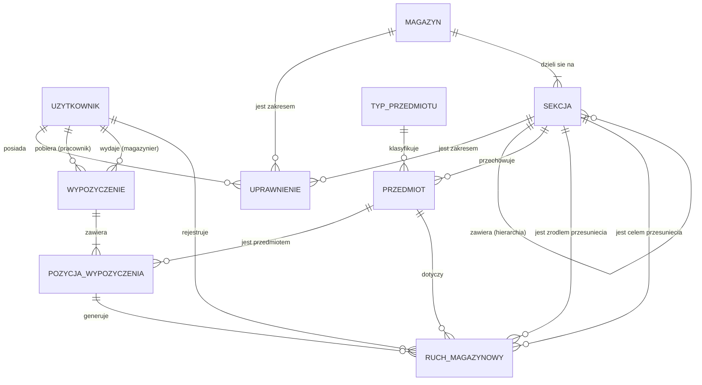

# a. Model konceptualny bazy danych — diagram związków encji

System zarządzania magazynem małego przedsiębiorstwa budowlanego.

Model konceptualny opisuje **co** jest przechowywane, bez rozstrzygania typów danych,
kluczy obcych i sposobu implementacji.

## Diagram ER

## Encje

| Encja | Opis | Atrybuty konceptualne |
|---|---|---|
| **UZYTKOWNIK** | Każda osoba korzystająca z systemu: administrator, magazynier, pracownik. | login, hasło, imię, nazwisko, telefon, adres, rola, czy aktywny |
| **MAGAZYN** | Fizyczna lokalizacja składowania. | nazwa, adres |
| **SEKCJA** | Miejsce składowania wewnątrz magazynu. Hierarchiczna: strefa → regał → półka. | nazwa, rodzaj |
| **TYP_PRZEDMIOTU** | Katalog asortymentu (np. „Wiertarka udarowa Bosch GSB", „Wkręt 4×40"). | nazwa, skrót, czy ewidencjonowany indywidualnie, **czy zużywalny**, jednostka miary |
| **PRZEDMIOT** | Konkretny zasób na stanie: pojedyncza sztuka z numerem seryjnym **albo** partia materiału w danej sekcji. | numer seryjny, ilość posiadana, data przyjęcia |
| **UPRAWNIENIE** | Poziom dostępu użytkownika do magazynu **albo** do pojedynczej sekcji. | poziom, data nadania |
| **WYPOZYCZENIE** | Dokument wydania: jedno zdarzenie „magazynier wydał pracownikowi zestaw rzeczy". Może mieszać rzeczy zwrotne i materiały zużywalne. | data wydania, termin zwrotu, data rozliczenia, status, uwagi |
| **POZYCJA_WYPOZYCZENIA** | Jedna linia dokumentu wydania. | **czy zużywalna**, ilość wydana, ilość zwrócona |
| **RUCH_MAGAZYNOWY** | Dziennik audytowy każdej zmiany stanu lub lokalizacji. | rodzaj, zmiana ilości, data, uwagi |

## Związki i liczności

| Związek | Liczność | Opcjonalność |
|---|---|---|
| MAGAZYN — SEKCJA | 1 : N | magazyn ma ≥ 1 sekcję; sekcja należy dokładnie do 1 magazynu |
| SEKCJA — SEKCJA (nadrzędna) | 1 : N | rekurencyjny; sekcja nadrzędna opcjonalna (korzeń hierarchii) |
| TYP_PRZEDMIOTU — PRZEDMIOT | 1 : N | typ może nie mieć egzemplarzy; przedmiot ma dokładnie 1 typ |
| SEKCJA — PRZEDMIOT | 1 : N | przedmiot leży w dokładnie 1 sekcji |
| UZYTKOWNIK — UPRAWNIENIE | 1 : N | uprawnienie dotyczy 1 użytkownika |
| MAGAZYN / SEKCJA — UPRAWNIENIE | 1 : N | uprawnienie dotyczy albo magazynu albo sekcji |
| UZYTKOWNIK — WYPOZYCZENIE (pracownik) | 1 : N | wypożyczenie ma 1 pracownika-pobierającego |
| UZYTKOWNIK — WYPOZYCZENIE (magazynier) | 1 : N | wypożyczenie ma 1 magazyniera wydającego |
| WYPOZYCZENIE — POZYCJA_WYPOZYCZENIA | 1 : N | dokument ma ≥ 1 pozycję |
| PRZEDMIOT — POZYCJA_WYPOZYCZENIA | 1 : N | pozycja dotyczy 1 przedmiotu |
| PRZEDMIOT — RUCH_MAGAZYNOWY | 1 : N | ruch dotyczy 1 przedmiotu |
| UZYTKOWNIK — RUCH_MAGAZYNOWY | 1 : N | ruch rejestruje 1 użytkownik |
| POZYCJA_WYPOZYCZENIA — RUCH_MAGAZYNOWY | 1 : N | opcjonalny — ruchy przyjęcia/likwidacji nie wynikają z wypożyczenia |
| SEKCJA — RUCH_MAGAZYNOWY (źródło, cel) | 1 : N | opcjonalny — wypełniany wyłącznie dla przesunięć |

## Założenia dziedzinowe

1. **Dwa tryby ewidencji.** `TYP_PRZEDMIOTU` rozstrzyga, czy asortyment jest śledzony
   indywidualnie (narzędzia — każda sztuka osobny `PRZEDMIOT` z numerem seryjnym)
   czy zbiorczo (materiały — jeden `PRZEDMIOT` = partia o danej ilości w danej sekcji).
2. **Dwa cykle życia.** `TYP_PRZEDMIOTU` rozstrzyga również, czy asortyment jest
   *zwrotny* (narzędzia, przewody — wracają do magazynu), czy *zużywalny*
   (wkręty, piana — wydane schodzą ze stanu bezpowrotnie). Jeden dokument wydania
   może zawierać oba rodzaje pozycji; rozliczany jest wtedy, gdy wrócą wszystkie
   pozycje zwrotne.
3. **Rozdział własności od dostępności.** `PRZEDMIOT.ilość posiadana` to stan ewidencyjny;
   ilość aktualnie wypożyczona wynika z otwartych zwrotnych `POZYCJA_WYPOZYCZENIA`.
   Dostępne = posiadane − wypożyczone. Materiały zużywalne nie są tu liczone,
   bo zeszły ze stanu już przy wydaniu.
4. **Przesunięcia nie zmieniają stanu posiadania.** Przeniesienie rzeczy między
   sekcjami lub magazynami zmienia lokalizację: dla rzeczy seryjnej sekcję jej
   jedynego egzemplarza, dla materiału sypkiego — ilość pomiędzy partią źródłową
   a docelową. Suma posiadanych ilości pozostaje bez zmian.
5. **Usunięcie użytkownika odbywa się w sposób oznaczenia użytkownika jako nieaktywnego** (flaga *czy aktywny*), bo historia wypożyczeń
   i ruchów musi pozostać nienaruszona.
6. **Uprawnienia są addytywne względem roli.** Rola wyznacza zestaw funkcji w aplikacji,
   `UPRAWNIENIE` zawęża lub poszerza dostęp do konkretnych magazynów/sekcji.
