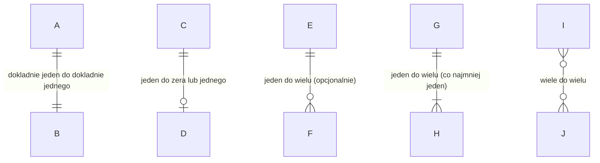

# Legenda — symbole na diagramach

Dwa diagramy w tym projekcie używają dwóch różnych notacji:

| Diagram | Plik | Notacja |
|---|---|---|
| Konceptualny (punkt a) | `01_model_konceptualny.md` | Mermaid ER — **crow's foot** (notacja „kurzej stopki") |
| Logiczny i fizyczny (punkty b, c) | `02_*.dbml`, `03_*.dbml` | DBML renderowany przez dbdiagram.io |

---

## 1. Mermaid — notacja kurzej stopki

Każdy związek zapisuje się jako:

```
ENCJA_LEWA  <licznosc_lewa>--<licznosc_prawa>  ENCJA_PRAWA : "nazwa związku"
```

Symbol liczności **czyta się od strony linii w stronę encji** — opisuje, ile
wystąpień *tej* encji odpowiada jednemu wystąpieniu encji po drugiej stronie.

### Symbole liczności

| Po lewej | Po prawej | Znaczenie | Czytanie |
|---|---|---|---|
| `\|o` | `o\|` | zero albo jeden | opcjonalne, pojedyncze |
| `\|\|` | `\|\|` | dokładnie jeden | obowiązkowe, pojedyncze |
| `}o` | `o{` | zero albo więcej | opcjonalne, wielokrotne |
| `}\|` | `\|{` | jeden albo więcej | obowiązkowe, wielokrotne |

Części symbolu znaczą:

- `|` — kreska prostopadła: **jeden** (dokładnie ten jeden)
- `o` — kółko: **zero** dopuszczalne (opcjonalność)
- `}` / `{` — kurza stopka: **wiele**

### Rodzaj linii

| Zapis | Linia | Znaczenie |
|---|---|---|
| `--` | ciągła | związek identyfikujący — encja podrzędna nie istnieje bez nadrzędnej |
| `..` | przerywana | związek nieidentyfikujący — encja podrzędna istnieje niezależnie |

W modelu konceptualnym używamy wyłącznie linii ciągłych.

### Przykłady z naszego diagramu

| Zapis | Jak czytać |
|---|---|
| `MAGAZYN \|\|--\|{ SEKCJA` | Magazyn ma **jedną lub więcej** sekcji. Sekcja należy do **dokładnie jednego** magazynu. |
| `SEKCJA \|\|--o{ PRZEDMIOT` | Sekcja przechowuje **zero lub więcej** przedmiotów. Przedmiot leży w **dokładnie jednej** sekcji. |
| `SEKCJA \|\|--o{ SEKCJA` | Związek rekurencyjny: sekcja zawiera **zero lub więcej** sekcji podrzędnych. |
| `WYPOZYCZENIE \|\|--\|{ POZYCJA_WYPOZYCZENIA` | Dokument ma **co najmniej jedną** pozycję — dokument bez pozycji nie ma sensu. |
| `UZYTKOWNIK \|\|--o{ WYPOZYCZENIE : "pobiera (pracownik)"` | Dwa osobne związki między tą samą parą encji rozróżnia **etykieta** — tu: kto bierze, a kto wydaje. |

### Ściąga wizualna



---

## 2. DBML / dbdiagram.io

### Bloki

| Zapis | Znaczenie |
|---|---|
| `Table nazwa { ... }` | tabela (relacja) |
| `Enum nazwa { ... }` | typ wyliczeniowy — w PostgreSQL `CREATE TYPE ... AS ENUM` |
| `indexes { ... }` | lista indeksów tabeli |
| `Note: '...'` | komentarz; `'''...'''` dla wielu linii |
| `Project nazwa { ... }` | metadane całego modelu |
| `//` | komentarz jednoliniowy |

### Ustawienia kolumny (w nawiasach kwadratowych)

| Zapis | Znaczenie | Odpowiednik SQL |
|---|---|---|
| `[pk]` | klucz główny | `PRIMARY KEY` |
| `[increment]` | wartość nadawana automatycznie | `GENERATED ALWAYS AS IDENTITY` |
| `[not null]` | wartość wymagana | `NOT NULL` |
| `[null]` | wartość opcjonalna | brak `NOT NULL` |
| `[unique]` | wartość niepowtarzalna | `UNIQUE` |
| `[default: 'x']` | wartość domyślna | `DEFAULT` |
| `` [default: `now()`] `` | domyślna z wyrażenia (backticki) | `DEFAULT now()` |
| `[note: '...']` | komentarz do kolumny | `COMMENT ON COLUMN` |
| `[ref: > tabela.kolumna]` | klucz obcy | `FOREIGN KEY ... REFERENCES` |

### Blok `indexes`

| Zapis | Znaczenie |
|---|---|
| `kolumna [name: 'idx_x']` | zwykły indeks o podanej nazwie |
| `kolumna [unique, name: 'uq_x']` | indeks unikalny |
| `(a, b) [unique, name: 'uq_ab']` | indeks złożony — nawias obejmuje kilka kolumn |
| `... [note: '...']` | wyjaśnienie, **po co** ten indeks istnieje |

W modelu fizycznym unikalność deklarujemy **w bloku `indexes` z nazwą**, a nie
jako `[unique]` przy kolumnie. Powód: `[unique]` przy kolumnie tworzy ograniczenie
bez nazwy, więc nie da się go powiązać z nazwą użytą w DDL. Zapis
`login [unique, name: 'uq_app_user_login']` odpowiada dokładnie
`CONSTRAINT uq_app_user_login UNIQUE (login)` z `04_model_fizyczny.sql`.

W modelu **logicznym** (`02`) jest odwrotnie — tam `[unique]` stoi przy kolumnie,
bo nazwy ograniczeń są decyzją implementacyjną i nie należą do tego poziomu.

Ta sama para kolumn może wystąpić w dwóch wpisach (np. `(item_type_id, section_id)`
jako `uq_item_bulk_per_section` i jako `idx_item_available`) — w DDL różnią się
predykatem `WHERE`, którego DBML nie wyraża.

### Symbole związków

Kierunek „dzioba" wskazuje stronę **jeden**:

| Zapis | Związek | Czytanie |
|---|---|---|
| `>` | wiele do jednego | wiele wierszy tej tabeli wskazuje na jeden wiersz tamtej |
| `<` | jeden do wielu | odwrotnie |
| `-` | jeden do jednego | |
| `<>` | wiele do wielu | dbdiagram sam dorysowuje tabelę łączącą |

Przykład: `warehouse_id bigint [ref: > warehouse.id]` — **wiele** sekcji
należy do **jednego** magazynu.

Na wyrenderowanym diagramie dbdiagram podpisuje końce linii:

- **`1`** — strona „jeden"
- **`*`** — strona „wiele"

Kolumny będące kluczem głównym mają ikonę klucza, a kolumny z `[ref]` są
połączone linią z kolumną docelową.

### Czego DBML **nie** pokazuje

Diagram dbdiagram to nie jest pełny obraz schematu. Nie da się w nim wyrazić:

| Element | Gdzie go szukać |
|---|---|
| ograniczenia `CHECK` (u nas **31**) | opisane w blokach `Note`, zdefiniowane w `04_model_fizyczny.sql` |
| predykaty indeksów częściowych (`WHERE ...`) | `Note` przy indeksie + `04_model_fizyczny.sql` |
| dziedziny (`CREATE DOMAIN qty`, `qty_delta`) | kolumna pokazuje `numeric(12,3)`; ograniczenie dziedziny opisuje `Note` |
| złożone klucze obce (u nas **3**) | `Note` + `04_model_fizyczny.sql` |
| widoki, wyzwalacze, funkcje, procedury | `05_pozostale_elementy.sql` |
| dziedziny (`CREATE DOMAIN`) | `04_model_fizyczny.sql` |

Złożone klucze obce zasługują na osobną uwagę: dbdiagram rysuje linię tylko
dla pierwszej kolumny pary, więc np. ograniczenie

```sql
FOREIGN KEY (item_type_id, is_serialized, is_consumable)
    REFERENCES item_type (id, is_serialized, is_consumable)
```

na diagramie wygląda jak zwykły klucz obcy `item.item_type_id → item_type.id`.
Dodatkowe kolumny, które pilnują zgodności flag, są widoczne wyłącznie w SQL.

---

## 3. Odpowiedniki między notacjami

| Pojęcie | Mermaid | DBML | PostgreSQL |
|---|---|---|---|
| Encja / tabela | `NAZWA` | `Table nazwa { }` | `CREATE TABLE` |
| Atrybut | w opisie tekstowym | wiersz w `Table` | kolumna |
| Klucz główny | niepokazywany | `[pk]` | `PRIMARY KEY` |
| Klucz obcy | linia związku | `[ref: >]` | `FOREIGN KEY` |
| Liczność „jeden" | `\|\|` | strona bez `*` | `NOT NULL` + `UNIQUE`/FK |
| Liczność „wiele" | `}o` / `o{` | `>` / `<` | FK bez `UNIQUE` |
| Opcjonalność | `o` w symbolu | `[null]` | kolumna dopuszcza `NULL` |
| Obowiązkowość | `\|` w symbolu | `[not null]` | `NOT NULL` |
| Dziedzina wartości | w opisie tekstowym | `Enum` | `ENUM` / `DOMAIN` / `CHECK` |
